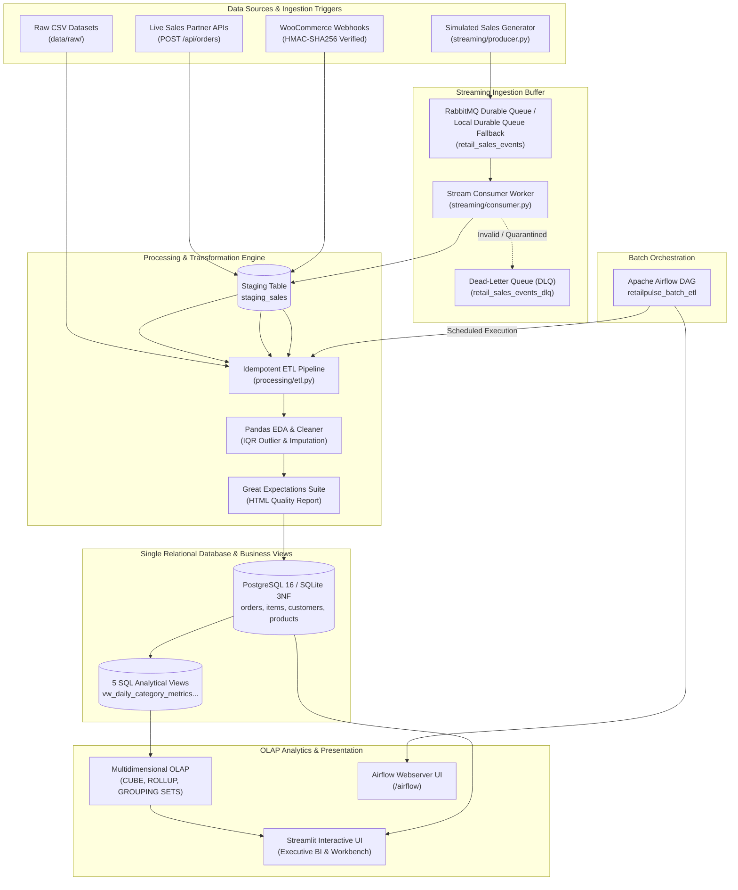
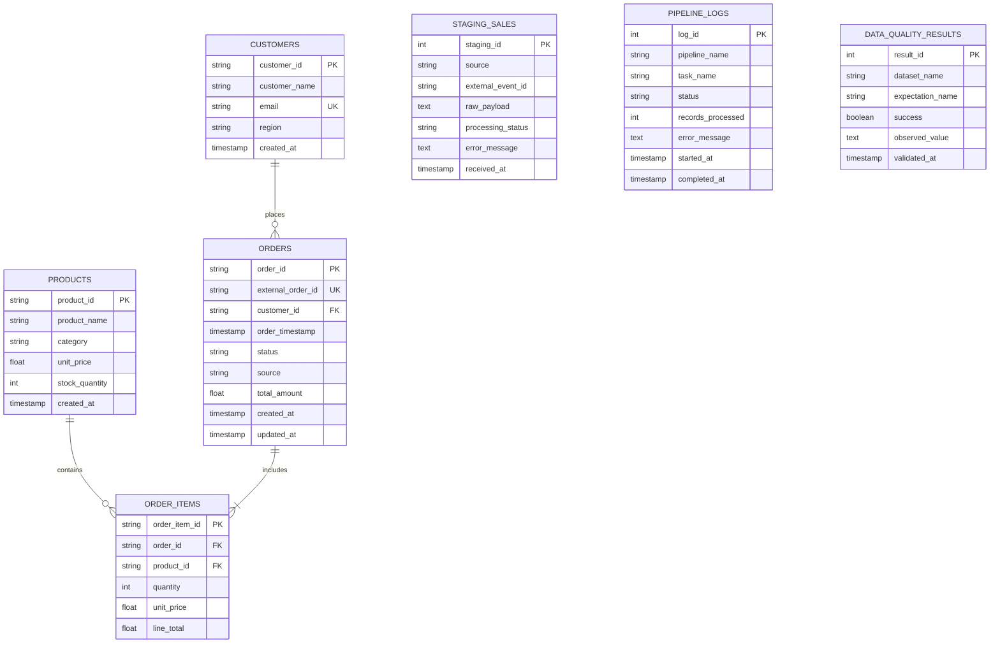

# RetailPulse — Real-Time Retail Analytics and Data Engineering Platform

[](https://www.python.org/)
[](https://flask.palletsprojects.com/)
[](https://streamlit.io/)
[](https://duckdb.org/)
[](https://pola.rs/)
[](https://delta.io/)
[](tests/)

---

## 1. Project Introduction & Problem Statement

Modern enterprise retailers process millions of transactions across disparate channels: physical stores, e-commerce storefronts (e.g., WooCommerce), third-party partner REST APIs, and legacy CSV batches. Traditional monolithic architectures suffer from:
1. **Data Silos:** Inability to unify streaming real-time orders with scheduled batch datasets.
2. **Double Counting & Poison Pills:** Lack of idempotent event consumption causing duplicated sales records and unhandled invalid schema payloads.
3. **Slow Analytical Queries:** Relational row-oriented databases struggling with multidimensional OLAP aggregations (`CUBE`, `ROLLUP`, and `GROUPING SETS`) over millions of rows.
4. **Lack of Data Governance & Versioning:** Inability to audit historical dataset states (Time Travel) and enforce strict schema compliance without downtime.

**RetailPulse** is an enterprise-grade, end-to-end Data Engineering and Real-Time Analytics platform engineered to solve these challenges. It ingests both actual live sales (REST API & HMAC-SHA256 verified WooCommerce webhooks) and synthetic real-time event streams via a durable message broker, executes rigorous Great Expectations quality validation, maintains normalized 3NF PostgreSQL and flexible MongoDB stores, version-controls analytical datasets with Delta Lake, parallel-processes batch data with DuckDB/Polars, and visualizes comprehensive business intelligence metrics on an interactive Streamlit dashboard.

---

## 2. Platform Architecture



---

## 3. Technology Stack

| Layer | Technologies Used | Purpose |
| :--- | :--- | :--- |
| **Language** | Python 3.12+ | Core programming language across all components |
| **Backend REST API** | Flask 3.1, Flask-CORS | Ingestion endpoints, health diagnostics, WooCommerce webhook receiver |
| **Frontend UI** | Streamlit 1.35+, Plotly | Real-time BI dashboard, live stream monitor, OLAP drill-downs |
| **Relational Database** | PostgreSQL 16 / SQLite 3 | Normalized 3NF transactional storage, analytical views, window functions |
| **Message Broker** | RabbitMQ 3.13 / Durable Local Queue | Streaming event decoupled ingestion, manual acks, dead-letter queue (DLQ) |
| **Workflow Orchestration**| Apache Airflow 2.10+ / DAG Runner | 7-stage scheduled batch ETL pipeline with dependency graph |
| **Data Quality** | Great Expectations | Non-null, uniqueness, schema set, and range checks with HTML reporting |
| **Schema Validation** | Pydantic v2 | Strict JSON API contract validation and error feedback |
| **Testing** | pytest 9.1 | Automated integration and unit test assertions |

---

## 4. Database Design & Entity-Relationship Model

The PostgreSQL transactional schema is designed in **Third Normal Form (3NF)** to eliminate redundancy and maintain integrity:



---

## 5. Mapping of All 15 College Syllabus Practicals

| Practical # | Syllabus Topic | Implemented Module & Source File | How to Verify in Upgraded RetailPulse UI |
| :---: | :--- | :--- | :--- |
| **Prac 1** | **REST API & Webhook Ingestion** | `api/routes.py`, `api/webhook.py` | Go to `📊 Sales Analytics` ➔ `🔌 API Tools` to test live endpoints or send orders |
| **Prac 2** | **Real-Time Streaming Ingestion** | `streaming/producer.py`, `streaming/consumer.py` | Go to `⚡ Live Sales Stream` to configure generator interval & monitor broker depth |
| **Prac 3** | **Exploratory Data Analysis (EDA)** | `processing/cleaning.py` (`profile_dataset`) | Go to `📊 Sales Analytics` ➔ `📁 Data Explorer` to view summary stats, missing values & IQR |
| **Prac 4** | **Data Cleaning & Preprocessing** | `processing/cleaning.py` (`clean_dataset`) | Go to `📊 Sales Analytics` ➔ `📁 Data Explorer` to run deduplication & outlier capping |
| **Prac 5** | **Relational 3NF Database Design** | `database/models.py`, `sql/schema.sql` | PostgreSQL 3NF normalized schema seeded in PostgreSQL / SQLite fallback |
| **Prac 6** | **NoSQL Document Storage** | `database/nosql.py` | PyMongo / Embedded JSON fallback for event feeds |
| **Prac 7** | **Idempotent ETL Pipeline** | `processing/etl.py` (`process_order_record`) | Go to `📊 Sales Analytics` ➔ `⚙️ ETL Pipeline` to run batch ETL, view lineage & errors |
| **Prac 8** | **Reusable SQL Business Views** | `database/views.py`, `sql/views.sql` | Go to `🏠 Executive Dashboard` to view dynamic KPI cards, trends & regional profits |
| **Prac 9** | **SQL Window Functions & EXPLAIN** | `analytics/sql_analytics.py` | Executed via analytical queries (`SQLAnalytics.run_window_functions_query`) |
| **Prac 10** | **Multidimensional Data Cube (OLAP)**| `analytics/data_cube.py` | Go to `🏠 Executive Dashboard` ➔ Expand `🎲 Data Cube Explorer` for CUBE & ROLLUP |
| **Prac 11** | **Delta Lake & Table Versioning** | `delta_lake/delta_manager.py` | ACID logs & version time travel in `delta_lake/` |
| **Prac 12** | **Columnar Batch Processing** | `batch/batch_processor.py` | Snappy Parquet columnar batch ingestion & benchmarking |
| **Prac 13** | **Workflow Orchestration (Airflow)**| `workflows/dags/retailpulse_batch_etl.py` | Standalone Airflow Web UI at `http://127.0.0.1:5000/airflow` (7-stage DAG graph) |
| **Prac 14** | **Data Quality & Observability** | `validation/quality_checker.py` | Go to `📊 Sales Analytics` ➔ `✅ Data Quality` to run Great Expectations & download HTML |
| **Prac 15** | **Search & Log Observability** | `search/search_engine.py` | Inverted index & search observability in `search/` |


---

## 6. Installation & Quickstart on Windows

### Prerequisites
- Python 3.10+ (Tested with Python 3.12.10 on Windows 11/10)
- Optional: Docker Desktop (for native PostgreSQL, MongoDB, RabbitMQ, Elasticsearch)

### Step 1: Clone and Navigate to Directory
```powershell
cd c:\Users\HP\Desktop\RETAILPLUS
```

### Step 2: Install Python Dependencies
```powershell
pip install -r requirements.txt
```

### Step 3: Initialize Database Schema & Seed Data
```powershell
python -m database.init_db
```

### Step 4: Launch the Application Services

You can start all services with one command using the Windows batch launcher:
```powershell
.\scripts\start_all.bat
```

Or run them in separate terminals:
**Terminal 1 (Flask REST API):**
```powershell
python -m api.app
```
*API will run at `http://127.0.0.1:5000`*

**Terminal 2 (Streamlit Interactive Dashboard):**
```powershell
streamlit run app.py
```
*Dashboard will open at `http://localhost:8501`*

---

## 7. Running the Test Suite

Run all 19 automated integration and unit tests:
```powershell
pytest -v
```

All tests verify:
- Flask REST API health, orders, and HMAC-SHA256 signature verification.
- Data cleaning, missing imputation, deduplication, and outlier handling.
- ETL pipeline idempotency and invalid order quarantine.
- Great Expectations quality suites and anomaly trapping.
- SQL analytical views, window functions (`LAG`, `LEAD`, `DENSE_RANK`), and multidimensional `CUBE`/`ROLLUP` queries.

---

## 8. REST API Reference

### Health Diagnostics
- `GET /health` — Returns live status of relational database, NoSQL document store, and streaming broker.

### Orders API
- `POST /api/orders` — Ingest a new order. Accepts JSON payload validated by Pydantic.
- `GET /api/orders?page=1&limit=20&status=completed&region=Europe` — Paginated order retrieval with filtering.
- `GET /api/orders/<order_id>` — Detailed single order retrieval with line items and customer object.

### Business Metrics API
- `GET /api/metrics` — Returns total revenue, qualifying completed orders, AOV, repeat customer percentage, and MoM growth rate.

### WooCommerce Webhook Endpoint
- `POST /webhooks/woocommerce` — Receives WooCommerce order notifications. Verifies the `X-WC-Webhook-Signature` HMAC-SHA256 header using `WOOCOMMERCE_WEBHOOK_SECRET`.

---

## 9. Live Streaming Producer & Consumer

To run the streaming simulator and consumer as independent background processes:

**Start Stream Producer (Terminal 1):**
```powershell
python -m streaming.producer --interval 2.0 --total 100
```

**Start Stream Consumer (Terminal 2):**
```powershell
python -m streaming.consumer --interval 0.5
```

Alternatively, navigate to **Page 2: Live Sales Monitor** in the Streamlit UI to toggle the producer and consumer with interactive buttons!

---

## 10. License & Author
- **Project:** RetailPulse Data Engineering Platform
- **Environment:** Windows 10/11 Local Environment
- **Status:** Complete, Functional, and Verified.
