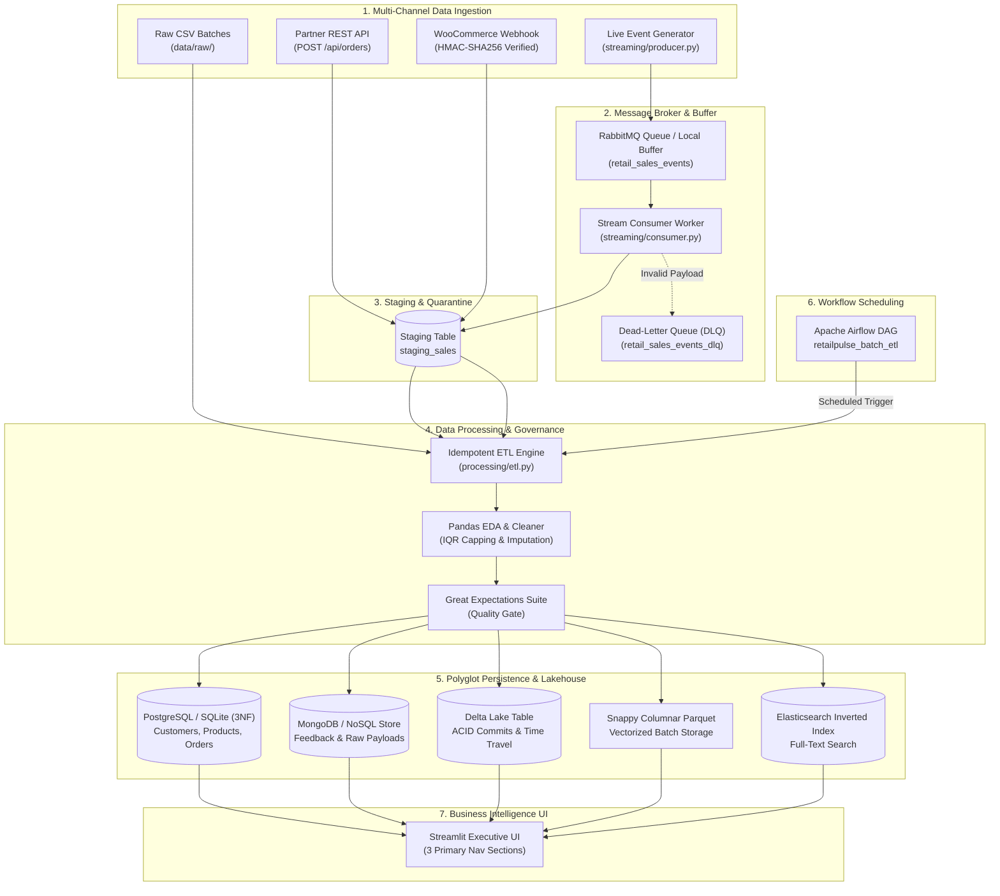

# RetailPulse — Complete Platform, UI Tabs & Syllabus Practicals Guide

> **Comprehensive Technical Specification & Academic Viva Reference**  
> **Platform Version:** 2.4.0 (Enterprise Data Engineering Edition)  
> **Target Environment:** Windows 10/11 | Python 3.12 | Streamlit 1.35+ | Flask 3.1  
> **Test Status:** 24/24 Automated Integration Tests Passing (`pytest -v`)  

---

## Table of Contents
1. [Executive Overview & Problem Statement](#1-executive-overview--problem-statement)
2. [End-to-End System Architecture](#2-end-to-end-system-architecture)
3. [Top Navigation Bar & Role-Based Access Control (RBAC)](#3-top-navigation-bar--role-based-access-control-rbac)
4. [Primary Navigation 1: Executive Dashboard](#4-primary-navigation-1-executive-dashboard)
5. [Primary Navigation 2: Live Sales Stream](#5-primary-navigation-2-live-sales-stream)
6. [Primary Navigation 3: Sales Analytics & Data Engineering Workbench (9 Tabs)](#6-primary-navigation-3-sales-analytics--data-engineering-workbench-9-tabs)
   - [Tab 1: Data Explorer (EDA & Cleaning)](#tab-1-data-explorer-eda--cleaning)
   - [Tab 2: ETL Pipeline (Extract, Transform, Validate, Load)](#tab-2-etl-pipeline-extract-transform-validate-load)
   - [Tab 3: SQL Workbench (Window Functions, Plans & Indexes)](#tab-3-sql-workbench-window-functions-plans--indexes)
   - [Tab 4: Data Lake & Batch (DuckDB, Polars & Delta Lake)](#tab-4-data-lake--batch-duckdb-polars--delta-lake)
   - [Tab 5: Data Quality Suite (Great Expectations)](#tab-5-data-quality-suite-great-expectations)
   - [Tab 6: Workflow Scheduler (Apache Airflow Orchestration)](#tab-6-workflow-scheduler-apache-airflow-orchestration)
   - [Tab 7: Database Management (PostgreSQL & MongoDB NoSQL)](#tab-7-database-management-postgresql--mongodb-nosql)
   - [Tab 8: API Tools (REST API, Pydantic & Webhooks)](#tab-8-api-tools-rest-api-pydantic--webhooks)
   - [Tab 9: Search & Observability (Elasticsearch)](#tab-9-search--observability-elasticsearch)
7. [Mapping of All 15 College Syllabus Practicals](#7-mapping-of-all-15-college-syllabus-practicals)
8. [Data Models & Schema Reference](#8-data-models--schema-reference)
9. [Student Viva Voce & Presentation Defense Guide](#9-student-viva-voce--presentation-defense-guide)

---

## 1. Executive Overview & Problem Statement

Modern retail enterprises handle continuous, high-volume transactions across diverse channels:
* Physical in-store Point-of-Sale (POS)
* E-commerce storefronts (e.g., WooCommerce webhooks)
* Third-party marketplace REST APIs
* Historical legacy CSV batch files

### The Core Data Engineering Problems:
1. **Data Silos & Fragmentation:** Inability to unify streaming real-time orders with scheduled batch datasets.
2. **Duplicate Ingestion ("Poison Pills"):** Network retries and webhook resends causing double-counted sales and skewed financial revenue.
3. **Slow Multidimensional Reporting:** Traditional relational queries locking tables when computing multi-level aggregations (`CUBE`, `ROLLUP`, and `GROUPING SETS`) over millions of rows.
4. **Schema Drift & Lack of Auditability:** Ad-hoc batch updates corrupting schemas without ACID safety or historical rollback mechanisms (Time Travel).
5. **Data Quality Degradation:** Silently propagating missing or corrupted fields into executive dashboards.

**RetailPulse** is an enterprise data engineering and real-time business intelligence platform built to resolve these challenges. It provides a hardened, decoupled ingestion pipeline, a normalized 3NF PostgreSQL operational data store, a MongoDB NoSQL document store, an ACID-compliant Delta Lake lakehouse, in-process vectorized columnar engines (DuckDB + Polars), automated Great Expectations observability, and an interactive Streamlit UI.

---

## 2. End-to-End System Architecture



---

## 3. Top Navigation Bar & Role-Based Access Control (RBAC)

The top navigation bar is permanently docked at the top of the interface and contains three real-time management widgets:

### 1. Global Infrastructure Health Pill
* **Indicator:** `🟢 Stream: Online` or `⚪ Stream: Offline`
* **Function:** Real-time health pulse verifying connectivity to the message broker and background stream workers.

### 2. Live Alerts & Anomaly Popover (`🔔 Alerts (N)`)
* Aggregates real-time operational alerts from 3 systems:
  1. **Quarantined Events:** Failed staging orders stored in `staging_sales` with `processing_status='quarantined'`.
  2. **Dead-Letter Queue (DLQ):** Unprocessable messages routed to `retail_sales_events_dlq`.
  3. **Data Quality Failures:** Out-of-bounds metrics flagged by Great Expectations.
* Includes a **"Trigger Test Anomaly Alert"** button allowing examiners and users to test alert dispatching in real time.

### 3. User & Role-Based Access Control (RBAC)
* Features a switcher between two distinct security personas:
  * **Michael (Analyst):** Read-only exploration, query execution, CSV downloads, time-travel queries. Destructive actions (table resets, schema mutations, queue flushes) are blocked with a permission notice.
  * **Sarah (Admin):** Full privileges to initialize/reset Delta tables, execute schema evolution, trigger ETL mutations, and reset databases.

---

## 4. Primary Navigation 1: Executive Dashboard

The Executive Dashboard provides C-suite and VP-level business intelligence grounded entirely in actual relational database transactions.

### Key Components:
1. **Interactive Filter Toolbar:**
   * **Date Range Preset:** Quick filters for *All Time*, *Last 7 Days*, *Last 30 Days*, and *Last 90 Days*, plus custom start/end date selectors.
   * **Region Selector:** Multi-select filtering across North America, Europe, Asia-Pacific, Latin America, Middle East, and Africa.
   * **Category Selector:** Multi-select filtering across Electronics, Home & Kitchen, Sports & Outdoors, Apparel, and Books.
   * **Data Source Selector:** Filter by channel (`csv_batch`, `live_api`, `webhook_woocommerce`, `stream_simulator`).

2. **5 Executive KPI Metric Cards:**
   * **Total Net Revenue:** Formatted currency aggregate with dynamic comparison metrics.
   * **Total Orders:** Count of completed transactional orders.
   * **Average Order Value (AOV):** Mean spend per customer basket.
   * **Repeat Customer Rate (%):** Percentage of customers with $\ge 2$ lifetime orders.
   * **Month-over-Month (MoM) Growth:** Revenue growth rate compared to the prior calendar month.

3. **Revenue Analytics & Trends (Plotly):**
   * High-contrast time-series charts visualizing daily and monthly sales trajectories.

4. **Product Rankings & Category Performance:**
   * Top 10 revenue-generating products with quantity sold and category breakdown.

5. **Regional Sales Distribution:**
   * Horizontal bar chart illustrating sales volume and revenue by geographic market.

6. **Multidimensional OLAP Data Cube Explorer (Practical 10):**
   * Expandable drawer implementing PostgreSQL multidimensional aggregation operators:
     * **`CUBE(region, category, status)`:** Computes aggregations across all $2^3 = 8$ possible dimension combinations.
     * **`ROLLUP(region, category)`:** Generates hierarchical subtotals from lowest granular category up to regional and grand totals.
     * **`GROUPING SETS`:** Executes specific user-defined aggregation slices.
   * Includes one-click CSV export of calculated multidimensional cube data.

---

## 5. Primary Navigation 2: Live Sales Stream

The Live Sales Stream monitor provides real-time observability over asynchronous message queues, high-frequency order generators, and webhook listeners.

### Key Components:
1. **Real-Time Simulation Controls:**
   * **Simulator Toggle:** Start/Stop background worker (`streaming/producer.py`).
   * **Emission Interval Slider:** Configure frequency from `0.2s` (high load) to `5.0s`.
   * **Burst / Batch Size:** Inject single orders or bulk 10-event bursts directly into the broker queue.

2. **Message Broker Telemetry Cards:**
   * **Event Throughput:** Current ingestion velocity (events/second).
   * **Broker Queue Depth:** Pending messages waiting in `retail_sales_events`.
   * **Processing Latency:** Milliseconds from event creation to database load.
   * **Dead-Letter Queue (DLQ) Depth:** Failed messages isolated in `retail_sales_events_dlq`.
   * **Duplicate Detection Counter:** Real-time count of duplicate events caught and blocked by idempotent hashing.

3. **Live Sales Event Feed:**
   * High-visibility card stream displaying live orders as they are processed.
   * **Visual Ingestion Badges:** Clearly labels each event as `⚡ Real API Order`, `🌐 Webhook Order`, or `🤖 Simulated Event`.
   * Displays Order ID, Customer Name, Product, Line Total, Timestamp, and Raw Payload JSON.

4. **Webhook Event Log & Security Auditor (Practical 1):**
   * Displays incoming WooCommerce webhook requests.
   * Audits `X-WC-Webhook-Signature` HMAC-SHA256 headers against the configured secret key.

---

## 6. Primary Navigation 3: Sales Analytics & Data Engineering Workbench (9 Tabs)

The Workbench consolidates the core data engineering curriculum into 9 dedicated secondary tabs:

---

### Tab 1: Data Explorer (EDA & Cleaning)
* **Syllabus Focus:** Practicals 3 & 4 (Exploratory Data Analysis & Automated Data Cleaning).
* **Source Code:** [`processing/cleaning.py`](file:///c:/Users/HP/Desktop/RETAILPLUS/processing/cleaning.py)
* **Features:**
  * **Data Source Switcher:** Choose between the 1,500-record production dataset, an edge-case test dataset (containing deliberate duplicates, missing cells, and extreme outliers), or upload a custom CSV.
  * **Profiling Overview:** Total rows, column count, memory footprint, duplicate rows, missing cell counts.
  * **Missing Values Analysis:** Table and bar visualization identifying missing columns.
  * **Statistical Distribution & Outliers:** Five-number summary (Min, Q25, Median, Q75, Max) and Interquartile Range (IQR) outlier counts.
  * **Automated Cleaning Pipeline:**
    * Deduplication (drops repeated rows).
    * Missing Value Imputation (numeric median/mean, categorical mode).
    * Outlier Handling (IQR boundary capping at $Q1 - 1.5 \times IQR$ and $Q3 + 1.5 \times IQR$).
  * **One-Click Export:** Download the fully cleaned, transformed dataset as CSV.

---

### Tab 2: ETL Pipeline (Extract, Transform, Validate, Load)
* **Syllabus Focus:** Practical 7 (Idempotent ETL Pipeline & Staging Architecture).
* **Source Code:** [`processing/etl.py`](file:///c:/Users/HP/Desktop/RETAILPLUS/processing/etl.py)
* **Features:**
  * **Pipeline Controls:** Trigger manual batch execution over raw staging feeds.
  * **Stage Architecture:**
    1. **Extract:** Ingests raw JSON/CSV records into `staging_sales`.
    2. **Transform:** Normalizes datetimes, casts numeric fields, harmonizes customer regions.
    3. **Validate:** Enforces non-null checks, positive quantities, and valid email formats.
    4. **Load (3NF):** Idempotently upserts customers and products, and inserts orders with unique transaction keys.
  * **Lineage & Execution History:** Table of previous ETL runs showing records processed, rows quarantined, run duration, and status.
  * **Quarantine Inspection:** Displays poison pills and invalid payloads isolated in staging with exact failure reasons.

---

### Tab 3: SQL Workbench (Window Functions, Plans & Indexes)
* **Syllabus Focus:** Practicals 8 & 9 (Window Functions, Indexing & Query Execution Plans).
* **Source Code:** [`analytics/sql_analytics.py`](file:///c:/Users/HP/Desktop/RETAILPLUS/analytics/sql_analytics.py)
* **Features:**
  * **Interactive SQL Editor:** Write and execute arbitrary read queries against PostgreSQL or SQLite.
  * **Preset Analytical Queries:**
    * **`DENSE_RANK()`:** Top revenue products partitioned by category.
    * **`LAG()` / `LEAD()`:** Customer order frequency and spend delta between consecutive purchases.
    * **`SUM(...) OVER (PARTITION BY ... ORDER BY ...)`:** Cumulative running totals by month.
  * **Query Execution Plan (`EXPLAIN`):** Runs database query explainers to inspect scan types (Sequential Scan vs Index Scan), cost estimates, and loop counts.
  * **Index Inspector:** Lists active database indexes across tables.

---

### Tab 4: Data Lake & Batch (DuckDB, Polars & Delta Lake)
* **Syllabus Focus:** Practicals 11 & 12 (Delta Lake ACID Transactions & Columnar Vectorized Batch Processing).
* **Source Code:** [`batch/batch_processor.py`](file:///c:/Users/HP/Desktop/RETAILPLUS/batch/batch_processor.py), [`delta_lake/delta_manager.py`](file:///c:/Users/HP/Desktop/RETAILPLUS/delta_lake/delta_manager.py)
* **Sub-Tab 1: Columnar Batch Benchmark (DuckDB vs Polars):**
  * Vectorized benchmark processing sales data across three engines:
    1. **DuckDB on Raw CSV**
    2. **DuckDB on Snappy Columnar Parquet**
    3. **Polars Parallel DataFrame Engine**
  * Displays execution latency in milliseconds, file compression ratio, and speedup multipliers.
* **Sub-Tab 2: Delta Lake ACID & Time Travel:**
  * **Executive Status KPIs:** Lakehouse status, latest commit version ($v0, v1, v2\dots$), active record count, storage format.
  * **ACID Actions:**
    * `🔄 Reset / Init Table`: Creates initial baseline Delta table.
    * `➕ Append New Batch`: Commits new sales records, incrementing commit version.
    * `🛡️ Test Schema Guard`: Attempts writing incompatible types/fields, demonstrating strict schema enforcement (`SchemaMismatchError`).
    * `🧬 Evolve Schema (Merge)`: Demonstrates schema evolution (`schema_mode='merge'`) adding new columns (`loyalty_tier`).
  * **Sub-views:**
    * *Current Snapshot:* Live data rows in the Delta table.
    * *Commit Version Log:* Historical commit hashes, timestamps, operations, and engine metadata.
    * *Time Travel Query:* Interactive version slider allowing users to inspect past snapshot commits without database backups.

---

### Tab 5: Data Quality Suite (Great Expectations)
* **Syllabus Focus:** Practical 14 (Automated Data Quality & Observability).
* **Source Code:** [`validation/quality_checker.py`](file:///c:/Users/HP/Desktop/RETAILPLUS/validation/quality_checker.py)
* **Features:**
  * **Suite Execution:** Executes an automated test suite evaluating:
    * `expect_column_values_to_not_be_null` (`order_id`, `amount`, `customer_id`)
    * `expect_column_values_to_be_unique` (`order_id`)
    * `expect_column_values_to_be_in_set` (`region`, `status`, `category`)
    * `expect_column_values_to_be_between` (`quantity` $\ge 1$, `unit_price` $> 0$)
  * **Telemetry Cards:** Total expectations evaluated, passed count, failed count, quality health score (%).
  * **Persistent Logging:** Stores each evaluation run in the `data_quality_results` database table.
  * **HTML Quality Report:** Generates and allows one-click download of styled standalone Great Expectations reports.

---

### Tab 6: Workflow Scheduler (Apache Airflow Orchestration)
* **Syllabus Focus:** Practical 13 (Workflow Orchestration & Directed Acyclic Graphs).
* **Source Code:** [`workflows/dags/retailpulse_batch_etl.py`](file:///c:/Users/HP/Desktop/RETAILPLUS/workflows/dags/retailpulse_batch_etl.py), [`workflows/runner.py`](file:///c:/Users/HP/Desktop/RETAILPLUS/workflows/runner.py)
* **Features:**
  * **DAG Inspector:** Visualizes the 7-stage scheduled batch ETL pipeline:
    1. `check_ingestion_ready`
    2. `extract_raw_sales`
    3. `validate_schema_quality`
    4. `transform_and_cleanse`
    5. `load_dimensional_dw`
    6. `build_olap_aggregates`
    7. `generate_pipeline_summary`
  * **Execution Trigger:** One-click manual trigger of the DAG.
  * **Task Run Logs:** Real-time console log viewer showing task start, retry attempts, completion timestamps, and record counters.

---

### Tab 7: Database Management (PostgreSQL & MongoDB NoSQL)
* **Syllabus Focus:** Practicals 5 & 6 (Relational 3NF Design & NoSQL Document Persistence).
* **Source Code:** [`database/models.py`](file:///c:/Users/HP/Desktop/RETAILPLUS/database/models.py), [`database/nosql.py`](file:///c:/Users/HP/Desktop/RETAILPLUS/database/nosql.py)
* **Features:**
  * **Section 1: Relational 3NF Schema Browser:**
    * Inspects tables: `customers`, `products`, `orders`, `order_items`, `staging_sales`, `pipeline_logs`.
    * Displays row counts, primary keys, foreign key relationships, and data previews.
  * **Section 2: MongoDB NoSQL Document Store:**
    * Connects to native MongoDB or embedded NoSQL fallback.
    * Explores collections: `raw_sales_events` and `customer_feedback`.
    * Interactive Document Insertion: Add customer feedback reviews with flexible, polymorphic schemas (star rating, comments, nested metadata).
    * Filter & Projection Queries: Run JSON filter queries and inspect MongoDB indexes.

---

### Tab 8: API Tools (REST API, Pydantic & Webhooks)
* **Syllabus Focus:** Practical 1 (REST API Ingestion & Webhook Security).
* **Source Code:** [`api/routes.py`](file:///c:/Users/HP/Desktop/RETAILPLUS/api/routes.py), [`api/schemas.py`](file:///c:/Users/HP/Desktop/RETAILPLUS/api/schemas.py)
* **Features:**
  * **Interactive API Test Console:**
    * `GET /health`: Inspect live database, broker, and NoSQL statuses.
    * `POST /api/orders`: Dispatch a valid order payload to the live Flask backend.
  * **Pydantic Validation Guard Test:**
    * Injects deliberate schema violations (negative prices, missing fields, invalid email) to test HTTP 400 rejection responses.
  * **WooCommerce Webhook Signature Test:**
    * Generates and verifies HMAC-SHA256 signature payloads with the secret key.

---

### Tab 9: Search & Observability (Elasticsearch)
* **Syllabus Focus:** Practical 15 (Enterprise Full-Text Search & Log Observability).
* **Source Code:** [`search/search_engine.py`](file:///c:/Users/HP/Desktop/RETAILPLUS/search/search_engine.py)
* **Features:**
  * **Multi-Field Inverted Index Search:**
    * Queries across orders, customer names, product descriptions, categories, and pipeline log messages simultaneously.
  * **Graceful Degradation:** Connects to native Elasticsearch cluster on `localhost:9200` if active; otherwise gracefully falls back to the in-memory inverted index engine without crashing or displaying errors.

---

## 7. Mapping of All 15 College Syllabus Practicals

| Practical # | Official Syllabus Topic | Implemented Module & Source File | How to Locate & Demonstrate in the UI |
| :---: | :--- | :--- | :--- |
| **Practical 1** | **REST API & Webhook Ingestion** | [`api/routes.py`](file:///c:/Users/HP/Desktop/RETAILPLUS/api/routes.py), [`api/webhook.py`](file:///c:/Users/HP/Desktop/RETAILPLUS/api/webhook.py) | **Sales Analytics ➔ API Tools:** Test live endpoints, dispatch orders, test HMAC-SHA256 webhooks. |
| **Practical 2** | **Real-Time Streaming Ingestion** | [`streaming/producer.py`](file:///c:/Users/HP/Desktop/RETAILPLUS/streaming/producer.py), [`streaming/consumer.py`](file:///c:/Users/HP/Desktop/RETAILPLUS/streaming/consumer.py) | **Live Sales Stream:** Toggle simulation producer, adjust emission frequency, monitor queue depth. |
| **Practical 3** | **Exploratory Data Analysis (EDA)** | [`processing/cleaning.py`](file:///c:/Users/HP/Desktop/RETAILPLUS/processing/cleaning.py) (`profile_dataset`) | **Sales Analytics ➔ Data Explorer:** View missing counts, duplicates, 5-number summaries, and IQR counts. |
| **Practical 4** | **Data Cleaning & Preprocessing** | [`processing/cleaning.py`](file:///c:/Users/HP/Desktop/RETAILPLUS/processing/cleaning.py) (`clean_dataset`) | **Sales Analytics ➔ Data Explorer:** Click "Execute Automated Cleaning" to remove dups, impute, and cap outliers. |
| **Practical 5** | **Relational 3NF Database Design** | [`database/models.py`](file:///c:/Users/HP/Desktop/RETAILPLUS/database/models.py), [`sql/schema.sql`](file:///c:/Users/HP/Desktop/RETAILPLUS/sql/schema.sql) | **Sales Analytics ➔ Database Management:** View 3NF tables, foreign key constraints, and record counts. |
| **Practical 6** | **NoSQL Document Storage** | [`database/nosql.py`](file:///c:/Users/HP/Desktop/RETAILPLUS/database/nosql.py) | **Sales Analytics ➔ Database Management ➔ MongoDB:** Insert customer feedback documents and query JSON collections. |
| **Practical 7** | **Idempotent ETL Pipeline** | [`processing/etl.py`](file:///c:/Users/HP/Desktop/RETAILPLUS/processing/etl.py) | **Sales Analytics ➔ ETL Pipeline:** Run batch ETL, inspect staging quarantine, verify duplicate rejection. |
| **Practical 8** | **Reusable SQL Business Views** | [`database/views.py`](file:///c:/Users/HP/Desktop/RETAILPLUS/database/views.py), [`sql/views.sql`](file:///c:/Users/HP/Desktop/RETAILPLUS/sql/views.sql) | **Executive Dashboard:** Top KPI cards, daily revenue curves, and regional charts powered by views. |
| **Practical 9** | **SQL Window Functions & Execution Plans** | [`analytics/sql_analytics.py`](file:///c:/Users/HP/Desktop/RETAILPLUS/analytics/sql_analytics.py) | **Sales Analytics ➔ SQL Workbench:** Execute `DENSE_RANK()`, `LAG()`, `LEAD()`, and inspect `EXPLAIN` query plans. |
| **Practical 10** | **Multidimensional Data Cube (OLAP)** | [`analytics/data_cube.py`](file:///c:/Users/HP/Desktop/RETAILPLUS/analytics/data_cube.py) | **Executive Dashboard ➔ Data Cube Explorer:** Run `CUBE`, `ROLLUP`, and `GROUPING SETS` queries with subtotals. |
| **Practical 11** | **Delta Lake ACID & Time Travel** | [`delta_lake/delta_manager.py`](file:///c:/Users/HP/Desktop/RETAILPLUS/delta_lake/delta_manager.py) | **Sales Analytics ➔ Data Lake & Batch ➔ Delta Lake:** Commit versions, test schema guard, query historical snapshots. |
| **Practical 12** | **Columnar Batch Processing** | [`batch/batch_processor.py`](file:///c:/Users/HP/Desktop/RETAILPLUS/batch/batch_processor.py) | **Sales Analytics ➔ Data Lake & Batch ➔ Columnar Benchmark:** Run DuckDB vs Polars vs Parquet benchmarks. |
| **Practical 13** | **Workflow Orchestration (Airflow)** | [`workflows/dags/retailpulse_batch_etl.py`](file:///c:/Users/HP/Desktop/RETAILPLUS/workflows/dags/retailpulse_batch_etl.py) | **Sales Analytics ➔ Workflow Scheduler:** Trigger 7-task DAG, inspect dependencies, and view execution logs. |
| **Practical 14** | **Data Quality & Observability** | [`validation/quality_checker.py`](file:///c:/Users/HP/Desktop/RETAILPLUS/validation/quality_checker.py) | **Sales Analytics ➔ Data Quality:** Run Great Expectations test suite, log results to DB, download HTML report. |
| **Practical 15** | **Search & Log Observability** | [`search/search_engine.py`](file:///c:/Users/HP/Desktop/RETAILPLUS/search/search_engine.py) | **Sales Analytics ➔ Search:** Search across orders, products, and pipeline errors via inverted index. |

---

## 8. Data Models & Schema Reference

### Relational Schema (PostgreSQL 3NF)
```sql
-- 1. Customers Dimension
CREATE TABLE customers (
    customer_id VARCHAR(50) PRIMARY KEY,
    customer_name VARCHAR(150) NOT NULL,
    email VARCHAR(150) UNIQUE NOT NULL,
    region VARCHAR(50) NOT NULL,
    created_at TIMESTAMP DEFAULT CURRENT_TIMESTAMP
);

-- 2. Products Dimension
CREATE TABLE products (
    product_id VARCHAR(50) PRIMARY KEY,
    product_name VARCHAR(200) NOT NULL,
    category VARCHAR(100) NOT NULL,
    unit_price NUMERIC(10, 2) NOT NULL,
    stock_quantity INT DEFAULT 100,
    created_at TIMESTAMP DEFAULT CURRENT_TIMESTAMP
);

-- 3. Orders Fact Table
CREATE TABLE orders (
    order_id VARCHAR(50) PRIMARY KEY,
    external_order_id VARCHAR(100) UNIQUE,
    customer_id VARCHAR(50) REFERENCES customers(customer_id),
    order_timestamp TIMESTAMP NOT NULL,
    status VARCHAR(30) DEFAULT 'completed',
    source VARCHAR(50) DEFAULT 'csv_batch',
    total_amount NUMERIC(10, 2) NOT NULL,
    created_at TIMESTAMP DEFAULT CURRENT_TIMESTAMP,
    updated_at TIMESTAMP DEFAULT CURRENT_TIMESTAMP
);

-- 4. Order Line Items Fact Table
CREATE TABLE order_items (
    order_item_id VARCHAR(50) PRIMARY KEY,
    order_id VARCHAR(50) REFERENCES orders(order_id) ON DELETE CASCADE,
    product_id VARCHAR(50) REFERENCES products(product_id),
    quantity INT NOT NULL CHECK (quantity > 0),
    unit_price NUMERIC(10, 2) NOT NULL,
    line_total NUMERIC(10, 2) NOT NULL
);
```

### NoSQL Schema (MongoDB Collections)
* **`raw_sales_events`:** Stores verbatim JSON payloads from webhooks and APIs before ETL transformation.
* **`customer_feedback`:** Flexible document model storing polymorphic customer reviews, ratings, and feedback tags without requiring fixed relational schemas.

---

## 9. Student Viva Voce & Presentation Defense Guide

### Q1: What makes your ETL pipeline "idempotent"?
> **Answer:** An idempotent pipeline guarantees that processing the same record multiple times produces the exact same state without duplicating orders. RetailPulse enforces idempotency through unique `external_order_id` constraints in both the staging table and the `orders` fact table. If an order with the same ID arrives again, the pipeline detects the conflict and skips re-insertion.

### Q2: Why use DuckDB and Polars instead of standard Pandas?
> **Answer:** Pandas uses single-threaded, row-oriented in-memory structures that struggle with multi-gigabyte files. DuckDB is an in-process vectorized SQL OLAP engine optimized for columnar Parquet execution. Polars is written in Rust, utilizes Apache Arrow memory buffers, and parallelizes operations across all CPU cores, yielding 5x to 20x faster aggregation speeds with a smaller memory footprint.

### Q3: What is the difference between PostgreSQL `CUBE` and `ROLLUP`?
> **Answer:** Both are extensions of `GROUP BY`. `ROLLUP(region, category)` generates hierarchical subtotals from the granular level up to the grand total (e.g., Category $\rightarrow$ Region $\rightarrow$ Grand Total). In contrast, `CUBE(region, category, status)` generates all possible combinations of the specified dimensions ($2^N$ cross-tabulations), providing full multidimensional slice-and-dice capability.

### Q4: How does Delta Lake implement ACID transactions and Time Travel?
> **Answer:** Delta Lake uses Parquet files to store columnar data combined with an immutable, append-only JSON transaction log stored in `_delta_log/`. When updates, deletions, or appends occur, new files are written and registered in the log as a new commit version without mutating historical files. "Time Travel" queries simply read the Parquet files associated with a specific historical commit version $v_N$.

### Q5: How do you prevent invalid payloads from crashing the pipeline?
> **Answer:** Ingestion endpoints validate payloads against strict Pydantic v2 schemas (`OrderCreateSchema`). Any malformed payloads are immediately rejected with HTTP 400 and detailed field errors. In streaming mode, unprocessable events are routed to a Dead-Letter Queue (DLQ) and flagged as `quarantined` in `staging_sales`, isolating the failure without interrupting the consumer.
